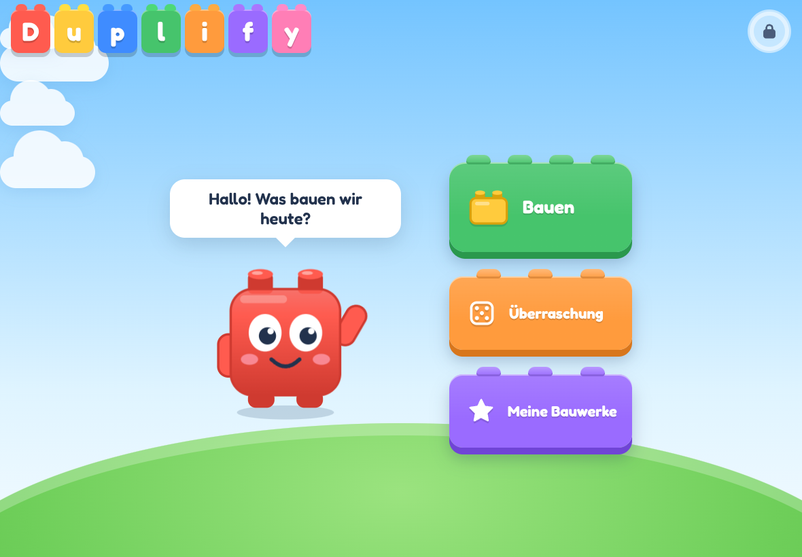
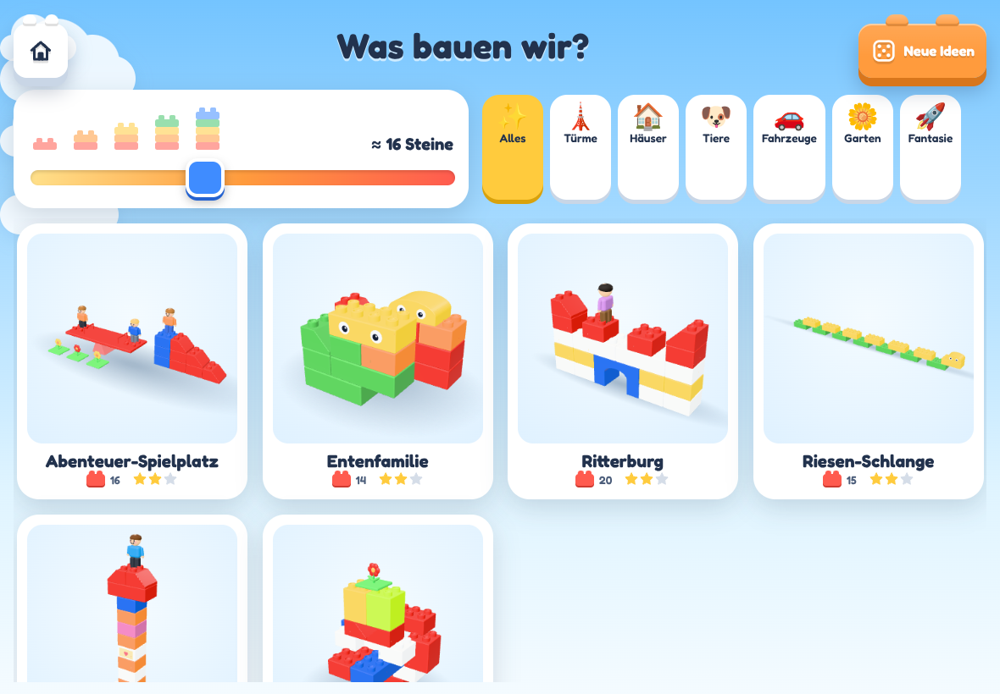
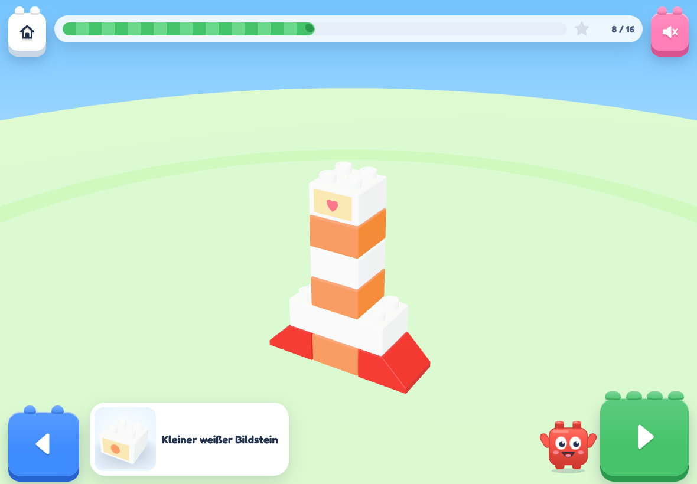
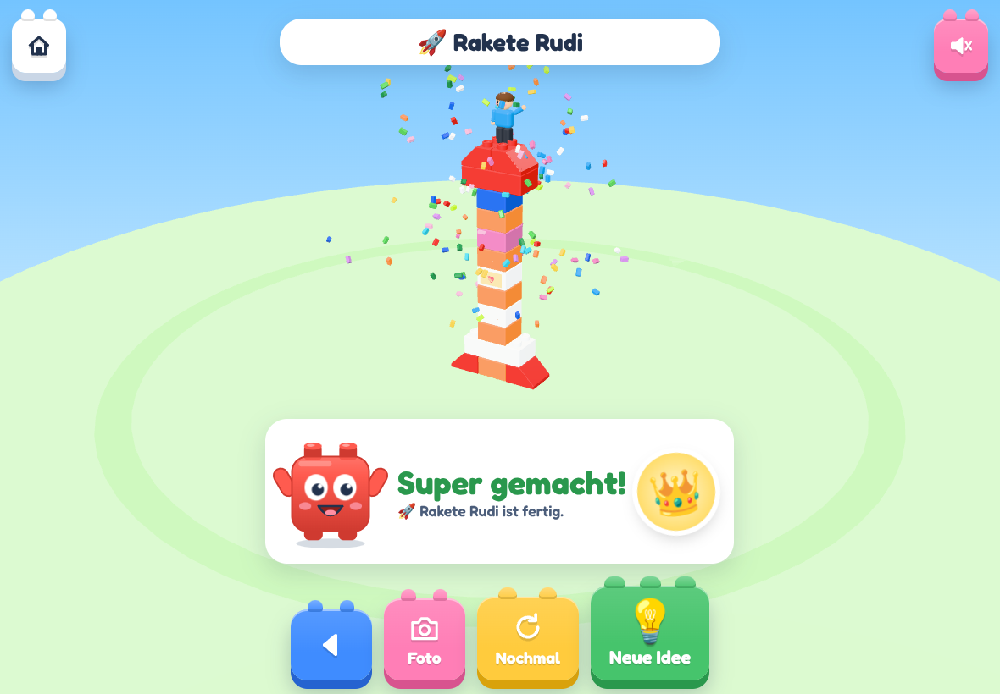
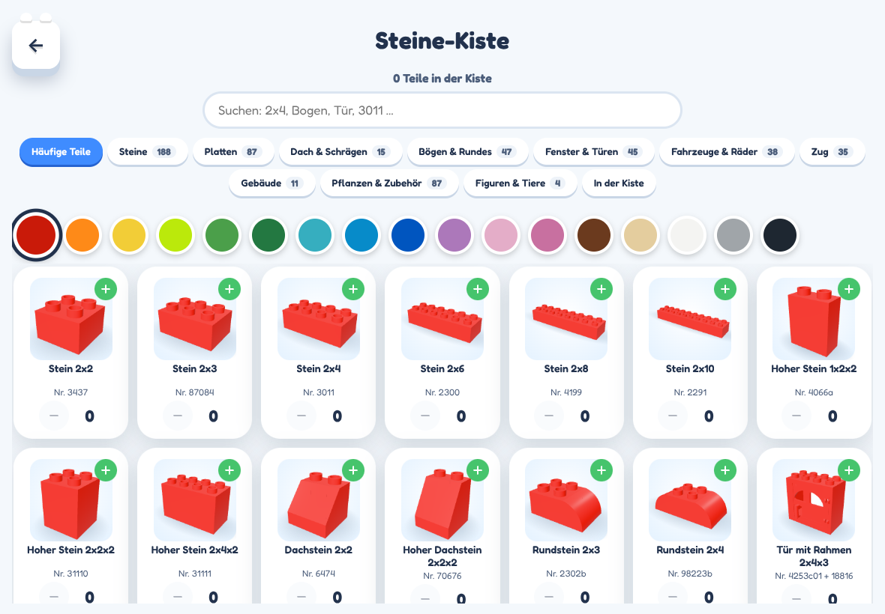
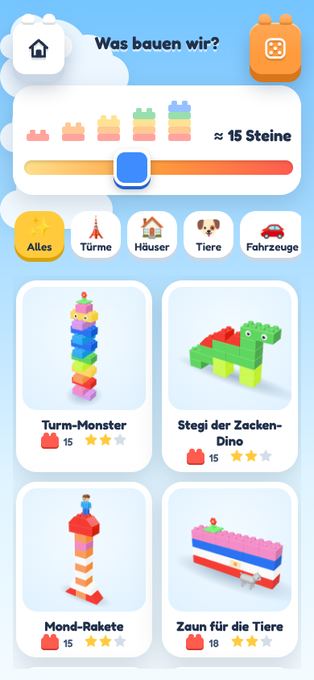

# Duplify – Bauen mit Noppi

Eine fröhliche Web-App für kleine Baumeister: Ihr tragt eure großen Bausteine (Duplo-kompatibel) ein, die App erfindet daraus passende Bauwerke und zeigt sie Schritt für Schritt mit 3D-Animationen vor. Noppi, ein kleiner roter Baustein mit Kulleraugen, begleitet das Kind.

| Start | Ideen | Bauen |
|---|---|---|
|  |  |  |

| Fertig! | Steine-Kiste (Eltern) | Handy |
|---|---|---|
|  |  |  |

## Was die App kann

- **Steine-Kiste:** Im Eltern-Bereich Farbe wählen und Teile antippen (+1). Der Katalog hat
  - Steine von 2x2 bis 2x10 und hohe Steine
  - Dach- und Rundsteine
  - Augen- und Bildsteine
  - Tür, Fenster und Bögen
  - Auto- und Zug-Basis
  - Blumen, Figuren, Tiere und Wippe

  Alles andere legt ihr als **eigenes Teil** mit Foto an.
- **Größen-Regler:** Ihr wählt, wie viele Steine ungefähr verbaut werden: von 3 bis „Alle Steine!“ (Mega-Turm). Das Kind kann auf die Türmchen tippen.
- **21 Baupläne**, die sich an euren Bestand anpassen:

  | Gruppe | Baupläne |
  |---|---|
  | Türme | Turm, Mega-Turm |
  | Häuser | Hochhaus (Fenster, Tür, Dach), Haus, Burg |
  | Tiere | Ente bzw. Entenfamilie, Hund mit Welpen, Giraffe, Schlange, Dino |
  | Fahrzeuge | Auto, Laster, Zug |
  | Fantasie | Rakete, Roboter, Brücke, Treppe, Pyramide, Zufalls-Skulptur |
  | Garten | Mauer, Blumengarten, Spielplatz |

  Jedes Bauwerk wird vor dem Anzeigen geprüft:
  - Alles hält auf mindestens 2 Noppen.
  - Nichts schwebt, nichts kippt.
  - Es werden nie mehr Teile gebraucht, als in der Kiste sind.
- **Bauanleitung in 3D:** Jeder Stein fliegt ein, ein blinkender Geisterstein zeigt den Platz, der Stein landet federnd mit Klick und Sternchen.
  - Eine Stimme sagt an: „Jetzt brauchen wir den großen roten Stein!“ Sie zählt auf Wunsch mit.
  - Die Kamera folgt bei hohen Türmen nach oben.
  - Wischen dreht das Modell.
- **Fertig-Feier:** Konfetti aus Mini-Steinen, das Bauwerk hüpft und dreht sich, Figuren winken. Dazu gibt es einen Sticker und den Knopf „Foto vom echten Bauwerk“.
- **Meine Bauwerke:** Galerie mit Fotos und Sticker-Album, jedes Bauwerk lässt sich nochmal bauen.
- **Kindersicher:**
  - Der Eltern-Bereich öffnet erst, wenn man das Schloss 3 Sekunden hält.
  - Keine Links, keine Werbung, kein Konto.
  - Alle Daten bleiben auf dem Gerät. Export und Import sind im Eltern-Bereich möglich.
- **Offline:** Nach dem ersten Öffnen läuft die App ohne Internet (PWA).

## Auf dem iPad oder Handy benutzen

Die App ist eine **Web-App (PWA)**: kein App Store nötig. Sie wird automatisch auf **GitHub Pages** veröffentlicht:

**https://gadoubleftothel.github.io/DUPLIFY/**

1. **Öffnen und installieren:**
   - iPad/iPhone: die Adresse in Safari öffnen → Teilen → **„Zum Home-Bildschirm“**.
   - Android: in Chrome → Menü → „App installieren“.
2. **Loslegen:**
   1. Das Schloss oben rechts 3 Sekunden halten.
   2. In der **Steine-Kiste** eure Steine eintragen (oder erst die **Beispiel-Kiste** ausprobieren).
   3. Zurück zum Start und auf „Bauen“ tippen.

Jeder Push auf den Branch `claude/exciting-newton-9ub33j` (oder `main`) baut die App neu und veröffentlicht sie; das erledigt der Workflow `.github/workflows/pages.yml`. Die App holt sich die neue Version beim nächsten Öffnen.

Einmalig nötig auf GitHub:
- Das Repo muss **öffentlich** sein (Settings → General → Change visibility).
- Unter Settings → **Pages** muss die Quelle auf **GitHub Actions** stehen.

Soll das Repo privat bleiben, geht es alternativ kostenlos über Netlify: Repo verbinden, die Einstellungen kommen aus `netlify.toml`.

Tipps:
- Ton und Stimme lassen sich in den Einstellungen abschalten.
- Mit einer **Grundplatte** (Einstellungen) kann nichts umkippen.
- Auf dem iPhone schaltet der Stumm-Schalter die Töne ab.

## Entwicklung

Voraussetzung: Node.js 22.

```bash
npm install
```

```bash
npm run dev
```

Danach <http://localhost:5173> öffnen. Zum Testen auf dem Tablet im selben WLAN:

```bash
npm run build && npm run preview -- --host
```

Danach `http://<IP-des-Rechners>:4173` öffnen. Installieren als App geht dort nicht, weil die Adresse kein HTTPS hat.

| Befehl | Zweck |
|---|---|
| `npm test` | Unit- und Eigenschafts-Tests der Kernlogik (Vitest) |
| `npm run e2e` | Ende-zu-Ende-Tests im Browser (Playwright, Tablet und Handy, inkl. Offline) |
| `npm run lint` / `npm run typecheck` | Code-Prüfung |
| `npm run icons` | App-Icons neu erzeugen |

Prüfseiten für Entwickler:
- `#/dev/teile` – alle Teile in 3D
- `#/dev/bauen` – Bau-Animation
- `#/dev/rezepte` – alle Baupläne mit der Beispiel-Kiste

### Aufbau

```
src/
  core/        Kernlogik ohne UI (komplett getestet)
    parts/       Teile-Katalog (Maße aus der Rebrickable-Datenbank)
    grid.ts      Raster: Noppen und Halb-Ebenen, Drehung
    validate.ts  Überlappung, Halt auf Noppen, Kippen
    steps.ts     Bau-Reihenfolge
    colorSolver  echte Farben aus dem Bestand verteilen
    engine.ts    Ideen erzeugen, Zielgröße treffen, sortieren
    recipes/     21 Baupläne + Baukasten (builder.ts)
  three/       3D: prozedurale Teile, Bau-Animation, Kamera, Konfetti, Vorschaubilder
  ui/          Seiten (Start, Ideen, Bauen, Galerie, Eltern) und Bausteine der Oberfläche
  audio/       synthetische Töne (Web Audio) und Sprachausgabe (de-DE)
  state/       gespeicherte Daten (zustand + localStorage, Fotos in IndexedDB)
```

Technik:
- Vite, React, TypeScript, three.js über `@react-three/fiber`
- zustand, wouter (Hash-Routing)
- vite-plugin-pwa
- Fredoka (OFL-Schrift)

Töne und Licht werden im Code erzeugt. Die App lädt nichts aus dem Internet nach.

## Hinweis

LEGO® und DUPLO® sind Marken der LEGO Gruppe. Duplify ist ein privates Projekt, nicht mit LEGO verbunden und verwendet keine LEGO-Logos. Für eine öffentliche Veröffentlichung sollte der Name nochmal geprüft werden.
